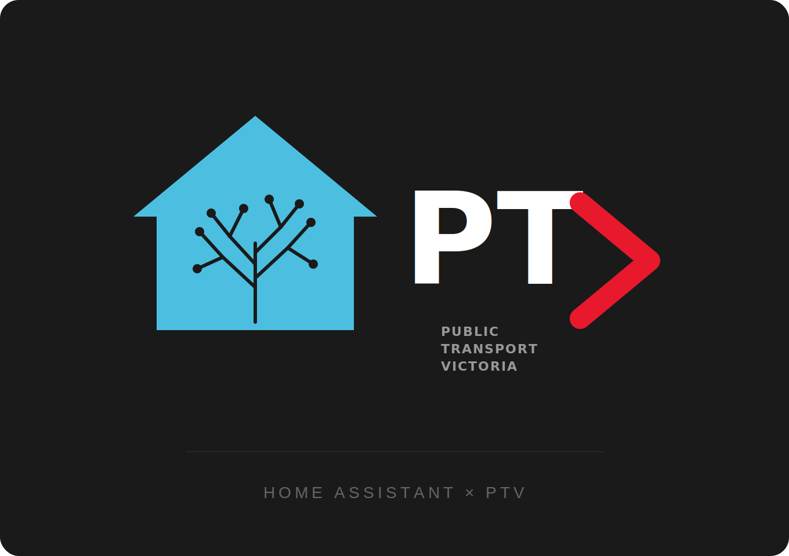

<p align="center">
  
</p>

> **AI Disclosure:** This project was written entirely by [Claude](https://claude.ai) (Anthropic), with direction and testing by a human. No code, configuration, or documentation was manually authored.

# PTV – Home Assistant Integration

A Home Assistant custom integration for **Public Transport Victoria (PTV)** metro train services. Provides real-time delays, cancellations, service alerts, vehicle positions, and scheduled departure times for any Melbourne Metro station.

[](https://github.com/hacs/integration)

---

## Features

- **Real-time trip updates** — delays, cancellations, schedule relationships
- **Service alerts** — published PTV disruption messages (signal faults, planned works, etc.)
- **Vehicle positions** — active train count and worst occupancy level per line
- **Next N departures** per station per direction — realtime where available, static timetable fallback otherwise
- **Problem level sensor** — `none` / `delays` / `alert` / `cancellations` / `major` for easy automation branching
- **Problem summary sensor** — TTS-ready plain English sentence
- **Multiple stations** — monitor any number of stations, each with configurable directions and departure count
- **Static timetable fallback** — always shows a departure time even when the realtime feed has nothing upcoming

## Sensors created per line

| Entity | Description |
|--------|-------------|
| `sensor.ptv_<line>_problem_level` | `none` / `delays` / `alert` / `cancellations` / `major` |
| `sensor.ptv_<line>_problem_summary` | Plain English status, suitable for TTS |
| `sensor.ptv_<line>_alert` | Current PTV alert message |
| `sensor.ptv_<line>_active_alerts` | Count of active alerts |
| `sensor.ptv_<line>_max_delay` | Worst current delay in minutes |
| `sensor.ptv_<line>_active_trains` | Trains currently running |
| `sensor.ptv_<line>_occupancy` | Worst occupancy (Empty → Full) |
| `sensor.ptv_<line>_status` | Combined status text |
| `binary_sensor.ptv_<line>_any_problem` | ON when anything is wrong |
| `binary_sensor.ptv_<line>_delays` | ON when delays ≥ 5 min |
| `binary_sensor.ptv_<line>_cancellations` | ON when services cancelled |
| `binary_sensor.ptv_<line>_service_alert` | ON when alert published |

## Sensors created per station

For each configured station (e.g. Ivanhoe, citybound, count=4):

| Entity | Description |
|--------|-------------|
| `sensor.ptv_<line>_<station>_citybound_1` | Next citybound departure (timestamp) |
| `sensor.ptv_<line>_<station>_citybound_2` | 2nd citybound departure |
| `sensor.ptv_<line>_<station>_citybound_3` | 3rd citybound departure |
| `sensor.ptv_<line>_<station>_citybound_4` | 4th citybound departure |
| `sensor.ptv_<line>_<station>_outbound_1` | Next outbound departure |
| ... | ... |

Each sensor has attributes: `formatted`, `delay_minutes`, `on_time`, `is_realtime`, `source`.

## Prerequisites

1. A free account at [opendata.transport.vic.gov.au](https://opendata.transport.vic.gov.au)
2. Your API key (found in your portal profile after registering)

> ⚠️ Keep your API key secret. Never commit it to version control.

## Installation

### HACS (recommended)

1. In Home Assistant go to **HACS → Integrations → ⋮ → Custom repositories**
2. Add `https://github.com/andrew-savage/ha-ptv`, category **Integration**
3. Click **Download**, restart Home Assistant
4. Go to **Settings → Devices & Services → Add Integration → PTV**

### Manual

Copy `custom_components/ptv/` into your HA `config/custom_components/` directory, restart.

## Setup

The config flow has four steps:

1. **API Key** — paste your Transport Victoria portal key
2. **Lines** — select which Melbourne Metro lines to monitor (multi-select), and set the polling interval (default 60 seconds)
3. **Service Alert Filters** — choose which alert types trigger your sensors. The recommended defaults include meaningful disruptions (no service, reduced service, significant delays, detour, modified service) and exclude noise like car park closures and informational notices. You can adjust this to taste:
   - **Include:** No service, Reduced service, Significant delays, Detour, Modified service
   - **Exclude by default:** Other effect (car parks, lift outages), No effect (informational only), Unknown effect, Stop moved, Accessibility issue, Additional service
4. **Stations** — add stations one at a time. For each station choose:
   - Station name (searchable dropdown of all network stations)
   - Directions: Both / Citybound only / Outbound only
   - Count: 1–4 upcoming trains to track
   - Select "(Done — no more stations)" when finished

## Automation Blueprint

A ready-to-use blueprint is included at `blueprints/ptv_commute_notifications.yaml`. Import it into Home Assistant and configure:

| Input | Description |
|-------|-------------|
| Line problem level sensor | `sensor.ptv_<line>_line_problem_level` |
| Line problem summary sensor | `sensor.ptv_<line>_line_problem_summary` |
| Next trains 1–4 | `sensor.ptv_<line>_<station>_citybound_1` through `_4` |
| Station name | Displayed in the notification title |
| Notify service | e.g. `notify.mobile_app_your_phone` |
| Morning status time | When to send the line status (e.g. 07:30) |
| Departure reminder time | When to send the next-trains list (e.g. 07:50) |
| Active days | Which days of the week to fire |

The blueprint sends two notifications daily:

- **Morning status** — fires at your chosen time with an emoji-coded title (✅ on time / ⏱️ delays / ⚠️ alert / 🚫 cancelled / 🚨 major) and a plain-English summary sentence
- **Departure reminder** — fires closer to when you leave, listing the next 4 trains with times and delay info. If there's an active disruption the summary is prepended so you always have context. Includes a tap action to open the PTV website.

## Example automation

```yaml
automation:
  - alias: "Morning commute briefing"
    trigger:
      - platform: time
        at: "07:45:00"
    condition:
      - condition: time
        weekday: [mon, tue, wed, thu, fri]
    action:
      - service: notify.mobile_app_your_phone
        data:
          title: >
            
            ✅ Hurstbridge On Time
            ⏱️ Hurstbridge Delays
            ⚠️ Hurstbridge Alert
            🚨 Hurstbridge Disruption
          message: >
            {{ states('sensor.ptv_hurstbridge_line_problem_summary') }}
            Next trains from Ivanhoe:
            1. {{ state_attr('sensor.ptv_hurstbridge_ivanhoe_citybound_1', 'formatted') }}
            2. {{ state_attr('sensor.ptv_hurstbridge_ivanhoe_citybound_2', 'formatted') }}
```

See `example_automations.yaml` for more ready-to-use automations.

## Dashboard card

See `dashboard_card.yaml` for a Lovelace markdown card showing next trains with colour-coded status indicators.

## API rate limits

The Transport Victoria API allows 24 calls per 60 seconds per feed. With three feeds (trip updates, service alerts, vehicle positions) the integration makes 3 API calls per poll. The default poll interval is 60 seconds, well within limits.

## Notes

- The trip updates feed does **not** include rail replacement buses, platform changes, or route deviations
- The static timetable cache refreshes daily at midnight and every 3 days regardless
- Cranbourne and Pakenham share a route ID in the GTFS feed — if you monitor both, they report identical data

## License

[MIT](LICENSE)
